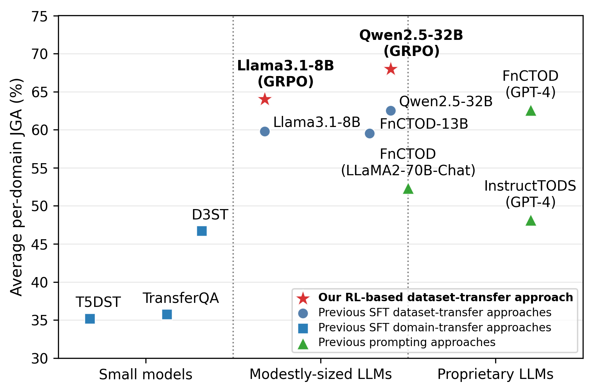

# Call, Reward, Repeat: Advancing Dialog State Tracking with GRPO and Function Calling

[](https://aclanthology.org/2026.eacl-srw.21/)
[](https://doi.org/10.18653/v1/2026.eacl-srw.21)

**🏆 Outstanding Paper Award — EACL 2026 Student Research Workshop.** [Award announcement (ITMO AI Talent Hub)](https://ai.itmo.ru/blog/9hzjjont31-pobedi-ai-talent-hub-eacl-ecir-ii-agenti)

Research code accompanying the paper by **Timur Ionov, Anna Marshalova, and Valentin Malykh**, published in the *Proceedings of EACL 2026 (Volume 4: Student Research Workshop)*, pp. 292–303.

**[Paper](https://aclanthology.org/2026.eacl-srw.21/) · [PDF](https://aclanthology.org/2026.eacl-srw.21.pdf) · [BibTeX](CITATION.bib) · [Reproduction](#reproducing-the-experiments) · [Citation](#citation)**

## Overview

Call, Reward, Repeat studies **dialogue state tracking (DST)** with large language models, combining **function calling** with **Group Relative Policy Optimization (GRPO)**. The method uses reinforcement learning to improve structured dialogue state predictions in a low-resource, cross-dataset setting.

The paper evaluates the approach on **MultiWOZ 2.1 and 2.4**, studies the effect of limited out-of-domain training data, and investigates tool-use-pretrained models as starting points for DST. See the paper for experimental results and comparison settings.



The repository includes workflows for supervised fine-tuning (SFT), GRPO, SFT followed by GRPO, and zero-shot evaluation, with experiment configurations for Qwen, Llama, and xLAM models.

**Research topics:** dialogue state tracking, dialog state tracking, task-oriented dialogue, function calling, tool use, reinforcement learning, GRPO, large language models, low-resource learning, cross-domain generalization, MultiWOZ.

## Repository guide

| Path | Contents |
| --- | --- |
| [`scripts/e2e/`](scripts/e2e/) | Training and evaluation experiment scripts |
| [`scripts/pretrain_preprocessing/`](scripts/pretrain_preprocessing/) | Data preprocessing and prompt construction |
| [`data/`](data/) | Dataset preparation instructions and configurations |
| [`src/`](src/) | Dataset-specific processing and evaluation utilities |
| [`chatbots/`](chatbots/) | Model interfaces |
| [`CITATION.bib`](CITATION.bib) | Paper citation from ACL Anthology |

## Environment

The original experiments used **Python 3.10.12**, **CUDA 12.6**, an **NVIDIA H100 80 GB**, and **NVIDIA release 24.08 (build 107063150)**. These describe the experimental environment, not verified minimum hardware requirements.

Clone the repository and run the installation step from its root:

```bash
git clone https://github.com/sir-timio/CallRewardRepeat.git
cd CallRewardRepeat
```

## Reproducing the experiments

### 1. Install requirements
```bash
pip install -r requirements.txt
```

### 2. Prepare the data

See [Data readme](data/README.md)


### 3. Preprocess data and build prompts

```bash
cd scripts/pretrain_preprocessing/

sh processing-taskmaster.sh
sh processing-woz.sh
sh processing-camres676.sh
sh processing-sgd.sh
sh processing-mse2e.sh


sh prompting-taskmaster.sh
sh prompting-woz.sh
sh prompting-camres676.sh
sh prompting-sgd.sh
sh prompting-mse2e.sh

sh create_finetune_data.sh
```


### 4. Run training and evaluation
```bash
cd scripts/e2e  # from the repository root

chmod +x sft_n_eval.sh
chmod +x grpo_n_eval.sh
chmod +x sft_grpo.sh
chmod +x zero-shot.sh
```

- `bash sft_n_eval.sh` - for SFT training and evaluation
- `bash grpo_n_eval.sh` - for GRPO training and evaluation
- `bash sft_grpo.sh` - for SFT-GRPO training and evaluation
- `bash zero-shot.sh` - for zero-shot evaluation


### Experiment configuration

The scripts in `scripts/e2e/` launch experiment sweeps over model choices, data sizes, and seeds. Review these settings and the GPU selection before running a full sweep.

Run each reproduction section from the repository root before entering its indicated subdirectory. The preprocessing example generates `*-pd-1.json` files used by the training scripts. The provided preprocessing loop covers `llama31` and `qwen`; xLAM experiments require corresponding prepared data and template settings.

## Citation

If you use this code or build on the method, please cite the **published paper**:

```bibtex
@inproceedings{ionov-etal-2026-call,
    title = "Call, Reward, Repeat: Advancing Dialog State Tracking with {GRPO} and Function Calling",
    author = "Ionov, Timur  and
      Marshalova, Anna  and
      Malykh, Valentin",
    editor = "Baez Santamaria, Selene  and
      Somayajula, Sai Ashish  and
      Yamaguchi, Atsuki",
    booktitle = "Proceedings of the 19th Conference of the {E}uropean Chapter of the {A}ssociation for {C}omputational {L}inguistics (Volume 4: Student Research Workshop)",
    month = mar,
    year = "2026",
    address = "Rabat, Morocco",
    publisher = "Association for Computational Linguistics",
    url = "https://aclanthology.org/2026.eacl-srw.21/",
    doi = "10.18653/v1/2026.eacl-srw.21",
    pages = "292--303",
    ISBN = "979-8-89176-383-8"
}
```

Download [`CITATION.bib`](CITATION.bib), or use GitHub's **Cite this repository** menu, configured through [`CITATION.cff`](CITATION.cff) to cite the paper.

## Acknowledgments

Much of this code is inherited from [FnCTOD](https://github.com/facebookresearch/FnCTOD). We thank its authors for their foundational work. Dataset preparation also builds on resources credited in the [data README](data/README.md). Please follow the respective upstream code, model, and dataset terms when reusing these resources.
